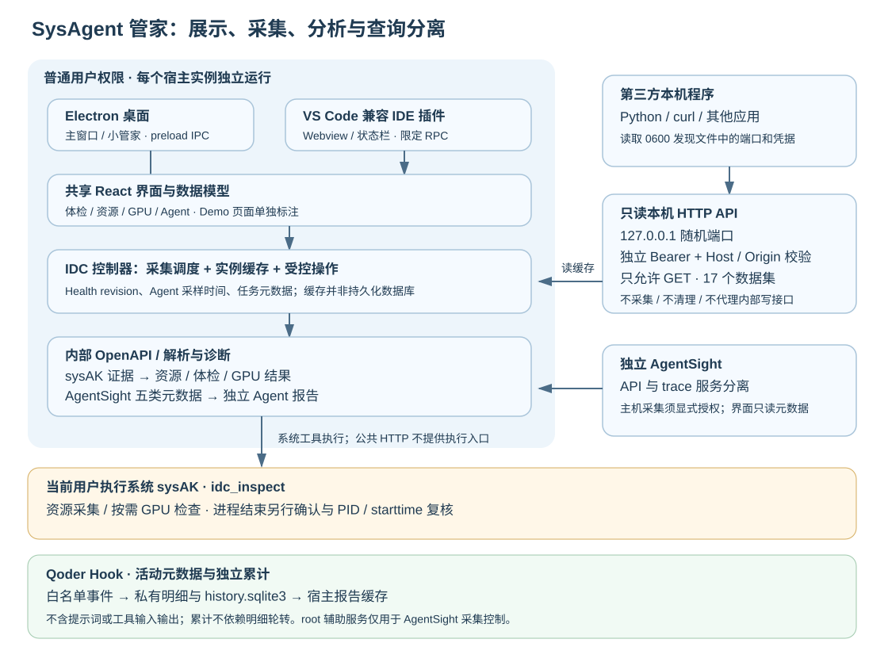
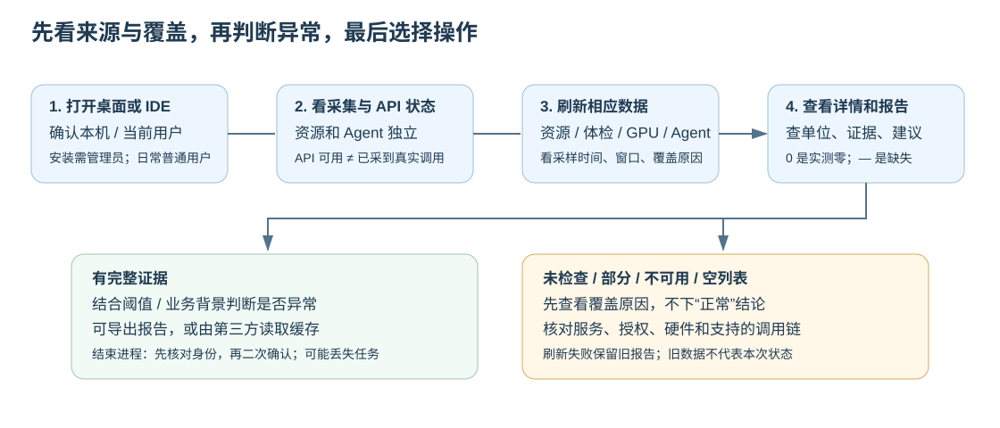

# SysAgent 管家功能与使用指南

本文面向首次使用桌面或 IDE 管家的用户，说明安装后的操作、指标含义、数据范围与隐私边界。[浏览器阅读版](./FUNCTION-USER-GUIDE.html)可在本地打开；复制阅读版时同时保留 `assets/user-guide/` 结构图目录。

> **先分清三件事：** 页面存在，不等于来源可用；请求成功，不等于设备或业务健康；读取缓存，不等于运行了一次采集。所有结论都应结合来源、时间、覆盖和执行状态。

## 阅读路线

- **首次使用：** 第 1–3 节介绍组件、入口与体检首页。安装步骤见[项目 README](../README.md)。
- **定位资源占用：** 第 4 节说明排行、功率与受控进程结束。
- **查看 GPU 或 Agent：** 第 5–6 节说明真实证据、图表与明细。
- **区分演示与真实能力：** 第 7–9 节说明演示页面、报告与能力边界。
- **脚本对接：** 第 10 节说明本机查询，完整示例见[HTTP API 文档](./LOCAL-HTTP-API.md)。

## 1. 管家是什么，哪些组件提供数据

| 模块 | 回答的问题 | 数据与能力 |
| --- | --- | --- |
| 体检首页 | 资源是否紧张？哪些检查需关注？ | 本机资源、评分、项目证据、报告与巡检配置；可选云端结论 |
| 资源详情 | 谁占 CPU、内存或产生 I/O？功率怎样？ | 已采集进程 Top10、Agent 筛选、CPU 进程功率估算、受控进程结束 |
| GPU 诊断 | 卡上有哪些指标与异常证据？ | 逐卡资源、按需原生检查和已有作业证据；事件案例属于演示 |
| Agent 管家 | 活动、工具、协作和调用状态怎样？ | Hook 累计统计与有界明细；AgentSight 会话、Token、中断、延迟与进程探活 |
| 设备管理 | 如何组织设备展示？ | 本机部分指标真实，远端设备与接入流程为演示 |
| 研发运维／日志分析 | 如何组织部署与日志分析流程？ | 内置示例和模拟任务，不部署应用、不读取真实日志 |
| 本机查询接口 | 其他应用可以读取哪些结果？ | 只读 HTTP、17 个缓存数据集和 OpenAPI 契约 |

### 桌面与 IDE

- **桌面：** Electron 主窗口与可拖动的悬浮小管家。
- **IDE：** VS Code 兼容宿主的 Webview 面板与状态栏，例如 VS Code、Qoder IDE。Qoder Desktop 独立应用和 JetBrains 不支持该 VSIX。

两端复用页面与业务逻辑，但每个宿主的资源缓存、巡检设置、设备标识和 HTTP 查询实例独立。相同用户环境可共享 Hook 存储与 AgentSight 来源，不表示资源快照自动同步。IDE 读取的是本地扩展宿主机器，不自动读取 SSH 远程工作区。



资源采集、Hook、AgentSight 和公共查询是独立边界。公共 HTTP 只能读缓存，不使用内部分析凭据，也不通过 root socket 执行操作。

## 2. 首次打开：先看来源，再看结果

### 2.1 安装前提

运行桌面需要 Linux x86_64 图形环境与 glibc 2.38+。IDE 需要 VS Code API 1.85+；Qoder Hook 运行需要 Linux 与 Python 3.6+。完整系统安装的依赖、校验和管理员授权见[README](../README.md)。

- 日常启动桌面和 IDE 使用普通用户，不用 sudo 启动 GUI。
- 系统资源需要已安装、当前用户可执行的 sysAK，并包含 `idc_inspect` 组件与匹配规则。管家依次查找 `SYSOM_SYSAK_BIN`、`/usr/bin/sysak`、`/usr/local/bin/sysak`、`PATH`；主 deb 不安装 sysAK，组件缺失时不联网下载。
- 包内私有 sysAK bundle 与 `sysom-idc.service` 用于 AgentSight 采集控制，不是系统资源采集的前提。
- AgentSight 与 Hook 各自提供独立来源；缺少其中一种不表示另一种也不可用。
- 云端巡检需要显式提供环境变量凭据，未配置时只展示本地结果。

### 2.2 桌面操作

1. 从应用菜单打开“SysAgent管家”，或执行 `sysagent-idc`。
2. 在主页查看体检与资源，点击左侧导航切换模块。
3. 关闭或最小化主页会收起为小管家；单击恢复，拖动调整位置。
4. 右键小管家选择“退出”才会彻底退出。该实例的巡检与查询服务随之停止，独立 AgentSight 服务不自动停止。

### 2.3 IDE 操作

1. 在命令面板使用“从 VSIX 安装”，选择完整交付目录中的插件并按提示重载。
2. 点击状态栏 SysAgent，或执行 **SysAgent管家: 打开体检主页**（`sysagent.openHome`）。
3. `sysagent.inspect` 提供立即巡检入口。
4. 关闭面板不等于扩展退出，可以再次打开；状态栏告警可进入相应详情。

### 2.4 无数据、部分结果与刷新失败

| 现象 | 应如何理解 |
| --- | --- |
| 未找到已安装的 sysAK | 本机未安装或不在解析路径，先准备完整系统工具 |
| 缺少 idc_inspect 组件 | 二进制存在但组件或规则不完整，不会自动下载 |
| 仅支持 Linux | 当前宿主不能运行此系统采集链路 |
| `—`、`null`、N/A、不可用 | 没有可靠数值，不转换为零或正常 |
| 已检查但结论受限 | 检查覆盖不足，只解释已有证据 |
| 旧结果 · 刷新失败 | 展示的是上次报告，应使用原采样时间 |
| 上次报告 · 更新中 | 新结果尚未返回，不当成本次已完成 |

资源与 Agent 的链路独立，应分别检查原因。修复来源问题后用“重试加载”或“刷新诊断”；“资源快照与诊断结论已刷新”不表示所有深度检查或云端分析都已完成。



## 3. 体检首页：概况、评分、巡检与云端报告

### 3.1 首页从上到下看什么

1. **健康中心与结论：** 当前设备、可评分范围和总体说明；有云端报告时提供云端结论。
2. **重要异常、其他异常、尚无定论：** 区分已确认异常和缺证据项目。
3. **资源卡片：** 数值、单位、状态、采样时间与详情入口。
4. **体检项目：** 各项执行状态、已有证据与建议。
5. **性能监视与操作记录：** 当前快照和本实例内已有操作，不是持续历史监控库。

### 3.2 常用按钮

| 按钮 | 行为 | 边界 |
| --- | --- | --- |
| 刷新整体数据 | 更新资源快照与本地诊断结论 | 不等于所有深度诊断重跑；有云端凭据时采集会上传 |
| 重新体检 | 运行既有体检链路并更新结果 | 需要等待并检查来源与覆盖，失败不是正常 |
| 体检报告 | 有云端报告时打开云端报告，否则打开本地报告 | 使用已有结果，不是历史报告库 |
| 巡检配置 | 设置本实例启停与周期 | 不开启 AgentSight eBPF 采集 |

真实采集模式不提供一键自动修复。“一键优化”等模拟操作不能用于真实业务；实际进程结束有独立二次确认。

### 3.3 评分规则

点击“评分计算规则”查看范围，计算为：

```text
分数 = 100 - 重要异常数 × (80 / 重要检查数)
           - 其他异常数 × (20 / 其他项与已知资源总数)
结果限制为 0～100；分母为 0 时该项扣分为 0。
```

- 重要检查数是重要项总数；其他分母是其他检查总数加已取得的资源百分比个数。未检查项仍在项目分母中，因此必须同时看覆盖提示。
- 重要异常来自已检查且使用率超过 90% 的重要项；其他异常包含其他已确认异常及超过 90% 的已知资源百分比。
- 功率 W 不是百分比预算，不用于“超过 90%”扣分。缺失资源比例不参与阈值比较。
- 100 分不代表未知项已检查；图例 `<60`、`60–80`、`80–90`、`90–100` 只帮助确定关注优先级。

### 3.4 巡检配置

1. 打开“巡检配置”，查看启停、上次与下次巡检。
2. 选择 1、5、15、30、60 分钟等预设，或输入自定义小时和分钟。
3. 合计须为 **1–1440 分钟的整数**；24 小时时分钟为 0，默认 5 分钟。
4. 保存后重新计时；暂停或退出宿主停止本实例巡检。

“暂无巡检”表示未记录上次运行，不表示故障；界面轮询缓存不等于实际执行巡检。

### 3.5 每项结论

| 显示 | 含义 | 下一步 |
| --- | --- | --- |
| 正常 | 本次已检查项未满足对应异常规则 | 核对时间和范围 |
| 异常 | 已有证据满足规则 | 查看证据、建议与业务影响 |
| 未检查 | 没有本项结果 | 不下正常结论 |
| 已检查 · 结论受限 | 取得部分证据 | 阅读缺失原因 |
| 已尝试 · 不可用 | 通道未取得可用证据 | 核对服务、权限、组件与硬件 |

根分区、目录、FD 和内存检查有真实链路，但扫描范围、进程数量、插件或权限会限制覆盖。独立 Agent 管家可用，不代表首页 Agent 状态检查完整；日志、网络、I/O 等项目也只能按实际执行状态解释。

### 3.6 云端巡检

默认不上传。只有同时提供 `SYSOM_POP_ENDPOINT`、`SYSOM_ACCESS_KEY_ID`、`SYSOM_ACCESS_KEY_SECRET` 时才进入云端预发模式；可选 `SYSOM_SECURITY_TOKEN`、`SYSOM_REGION_ID`（默认 `cn-hangzhou`）、`SYSOM_DEVICE_ID`。`SYSOM_IDC_UPLOAD=0|false|no|off` 强制关闭上传。凭据只由环境或已有密钥机制提供，不写入源码、界面、日志或命令行。

| 阶段 | 执行方 | 内容 |
| --- | --- | --- |
| 申请地址 | sysAK | `CreateHostInspectionUploadUrl` 获取预签名上传地址 |
| 上传 | sysAK | PUT 本次采集快照 |
| 提交 | sysAK | `SubmitHostInspection` 获取巡检标识 |
| 分析 | 云端 | 生成检查结论与报告 |
| 取报告 | 桌面／IDE | `GetHostInspection` 轮询，再调用 `GetInspectionReport` |

- 上传包含资源、进程与检查证据，不含 Agent 对话正文；接受上报范围后再配置。
- 上传成功后每 3 秒查询任务，最长等待 120 秒。上传失败保留本地结果并提示“本次仅本地采集”。
- 首页展示云端状态与进度；有报告时显示级别、巡检项与异常数、实例统计和重点异常。
- “体检报告”弹窗展示报告名、级别、主机与时间范围、检查项名称和逐项原因；没有项级结果时明确说明。
- 正常／建议／警告／错误／严重来自云端规则，**不是本机评分**；部分完成表示证据或检查不完整，不等于全部正常。
- 云端结果只存在当前宿主内存；退出不保留历史报告，新采集取代正在进行的轮询。查询 API 的 GET 不触发上传或轮询。

## 4. 资源详情：单位、排行、功率与进程操作

### 4.1 指标单位

| 资源 | 卡片指标 | 进程排行 | 不代表什么 |
| --- | --- | --- | --- |
| CPU | 整机使用率 | 进程占整机 CPU 的份额 | 不一定等于单核口径工具数值 |
| 内存 | 使用量、总量与比例 | RSS 常驻内存 | 不是全部虚拟地址空间 |
| 磁盘 | 文件系统空间使用与可用量 | 读写 I/O 速率，B/s | 不是目录大小或进程占据的磁盘容量 |
| 能耗 | 已测或估算的当前 CPU/GPU 功率，W | CPU 功率按进程 CPU 份额估算 | 不是累计电量 kWh，不是 GPU/Session 独占功率 |
| GPU | 利用率与逐卡资源 | 仅使用实际返回字段 | 卡级利用率不能冒充进程利用率 |

`1 GiB = 1024³ B`，`1 MiB = 1024² B`。0 是来源报告的零值；缺失、未知与不可用不表示零。

### 4.2 查谁占用资源

1. 点击资源卡片“详情”，核对采样时间、名称、PID、指标与单位。
2. 用名称或 PID 搜索，或切换“全部程序／只看 Agent”。
3. 排行按对应指标显示 Top10。Agent 根据常见进程名称白名单识别，可能漏识别，不自动推断 Session。
4. 采集保留有界排行，通常为整体 Top20 与 Agent Top20 的去重并集；HTTP 只能读取完整已缓存结果，不扩大采集范围。

筛选无结果不证明进程不存在。真实资源页不提供 Session 资源树或 Session 级释放 CPU/GPU。

### 4.3 能耗详情与进程 CPU 功率估算

能耗详情先显示**功率构成**（CPU、GPU、数值与来源），再显示**未归因 CPU 功率**和**进程 CPU 功率估算**排行。

- CPU 优先使用 RAPL package 功率。无有效读数时，以整机忙碌比例乘以全负载参考功率估算；默认参考值为每个逻辑核 5 W。
- GPU 优先使用传感器功率；无有效读数时，以利用率乘以功率上限估算，功率上限缺失时参考每卡 150 W。
- `SYSAGENT_CPU_FULL_LOAD_WATTS`、`SYSAGENT_GPU_FULL_LOAD_WATTS` 可校准估算参考值，要求 `0 < W ≤ 100000`，不改变实际传感器读数。
- 测量、估算、混合来源分别标注。只覆盖 CPU/GPU 已取得部分，不代表墙插整机功率。

```text
进程 CPU 功率估算 = CPU 功率 × 进程占整机 CPU 比例 / 整机忙碌 CPU 比例
```

归因需要有效的 CPU 与进程样本、可比较的采样窗口。窗口差容许最大 2 ms 或 CPU 窗口的 1%；无法对应时显示未知，不强行计算。未列出的进程与静态功率不强行分摊，GPU 功率不按 CPU 排名分摊，筛选不重新分配功率。

进程功率是估算，不是独立传感器测量。空排行可能表示样本缺失或无法归因，不代表零能耗。

### 4.4 结束进程

**此操作会结束整个进程，可能中断任务或丢失未保存数据。** 仅适用于当前用户可核实身份的非受保护进程，与公共查询完全分开。

1. 保存工作，确认目标不是必须保留的系统或业务进程。
2. 勾选界面允许的目标，最多选择 10 项，点击“清理所选进程”。
3. 二次确认中核对名称、PID 与 starttime；确认有效期 60 秒。
4. 执行链路复核快照、当前用户权限、受保护范围和进程身份，再发送 **SIGTERM**。
5. 逐项读取结果并核对刷新后的资源；发送成功不保证进程已经退出。

不删除文件、日志、缓存或目录，不自动强杀、不提高跨用户权限，不提供真实 Session 清理。只有“可结束”标记不足以绕过执行复核。

## 5. GPU 诊断：资源、执行状态与结论

GPU 页面分为 GPU 概览、GPU 诊断、异常事件分析、作业级深度剖析。资源采集和原生检查是不同操作。

### 5.1 GPU 概览

查看索引、名称、UUID、PCI 总线、利用率、显存、温度、功率、ECC 和 PCIe 等已有字段。点击“刷新本机 GPU 资源”只刷新资源，不执行原生 AI 诊断。

无 GPU、驱动或权限受限、尚未采集是不同状态。字段可独立缺失，ECC 未取得不显示为零。虚拟显示适配器不等于计算 GPU，资源可用也不代表 GX 分析可用。

### 5.2 GPU 诊断

1. 切换“GPU 诊断”，点击运行或重新检查。
2. 等待 sysAK 原生 `ai` 与本机分析返回。
3. 先看完成、部分、超时、截断、权限受限或错误等执行状态，再看正常、异常、未知或无 GPU 的结论。
4. 用搜索与 OK/WARN/ERROR 筛选检查项，查看证据和建议；导出保留全部已有检查项，不受页面筛选影响。

OK 只是某条检查级别，不表示全部完成；WARN 为风险，ERROR 为已返回异常证据。建议不自动执行。原生工具可能写诊断日志，不能把执行称为严格无副作用读取；HTTP 查询缓存不执行工具。

### 5.3 作业级证据

点击“采集本机作业证据”按需执行原生工具，再搜索或选择**已经返回的 PID**，查看 CPU、RSS、GPU 关联与 HANG/NCCL/Xid 等已有证据。选择 PID 只是查看结果，不对任意输入 PID 发起追踪，也不选择远端实例。

GX、硬件和驱动影响原生分析；独立资源指标仍可能可用。缺少 name、starttime 或采样窗口时保留不可用，不把命令行当进程名，不据 PID 确定跨快照身份。`--threshold 1s` 是诊断阈值，不是统一指标采样窗口。卡级 NVML 利用率不代替进程 SM 利用率。

真实页面不提供连续 Timeline、Kernel 热点追踪或全作业生命周期分析。

### 5.4 异常案例与离线 Profiling

异常事件分析中的越界、HANG、OOM、通信案例，及离线 Profiling 的实例、区域、PID 和采集范围表单均为演示。分析、时间线、日报与告警渠道使用示例数据，不采集输入的实例或 PID、不证明本机故障、不接入真实通知。

## 6. Agent 管家：Hook 活动与 AgentSight 调用证据

### 6.1 先区分两种来源与三个时间范围

| 来源／范围 | 提供什么 | 边界 |
| --- | --- | --- |
| Hook 累计历史 | 六项卡片、趋势、类别、会话／工具排行、协作统计 | 独立 SQLite 持久累计，不从最新明细重算 |
| Hook 近 24h 汇总与明细 | Agent 汇总、会话分组、事件轨迹与证据 | 最多处理 5,000 条事件、16 个 Agent；明细最多最新 200 条 |
| AgentSight 近 24h | 进程探活、会话与 Token、中断、未处理汇总、延迟 | 进程最多 256、会话最多 500、中断明细最多 200；以 coverage 为准 |

Hook 不提供 Token 或模型调用延迟。AgentSight 与 Hook 不跨来源关联 Session ID 或 PID；同名 Agent 不代表同一组会话。来源不可用显示 `—` 或原因，不能改成零。

进入页面或刷新诊断会通过宿主获取来源并分析；报告缓存超过 60 秒会重新获取，手动刷新不使用缓存。公共 HTTP GET 只读已有报告，行为不同。诊断不发起付费模型调用、不自动修复或重启 Agent。

### 6.2 顶部六项累计统计

| 卡片 | 含义 |
| --- | --- |
| 已记录会话 | 已记录且可识别的 Hook 会话数，不是全部宿主会话 |
| Hook 事件 | 累计写入的规范事件数 |
| 提交提问 | 提问提交事件数，不保存提问正文 |
| 工具开始 | 工具开始回调数，不是任务完成数 |
| 轮次失败 | 已记录轮次失败事件数，需结合证据关注 |
| 未配对开始 | 未记录到配对结束的工具开始，不等于卡死 |

累计保存在 `history.sqlite3`，不因明细轮转、筛选或分页而减少。保留明细可用于建立累计基线，记录启用前已删除的数据无法恢复。累计存储不可用时不拿最新 200 条明细推断全历史。

工具失败、授权拒绝、用户中断是来源事件，不直接等于 Agent 故障；回调数量不应解读为任务成功率。

### 6.3 七个视图怎么用

| 视图 | 内容与操作 |
| --- | --- |
| 总体统计 | 默认视图；活动趋势、事件构成、会话活动前 8、工具活动前 6、分类统计、需关注问题、延迟对比与进程探活 |
| 会话与明细 | Hook 会话、会话轨迹、近 24h Agent 汇总、最新元数据；按 Agent、事件类型、类别、Session/工具/模型搜索 |
| 工具与协作 | 工具开始/结束/失败/显式中断、子 Agent、任务、信息补充、授权、压缩与工具累计表 |
| 会话 | AgentSight 会话与已记录 Token，搜索 Agent/ID/Model，展开已有关联中断 |
| 中断 | AgentSight 中断类型筛选、只读证据与已有会话跳转 |
| 延迟 | 切换比较指标，查看完整调用与流式调用数及延迟表 |
| 数据接入 | 查看两种来源的覆盖、原因与边界，不安装或开启采集 |

**图表到明细：** 点击趋势时段、类别、工具或分类入口，进入“会话与明细”并筛选已取得的最新事件。累计排行只显示累计，不保证其对应事件仍在明细中；会话累计排行使用匿名标识，不自动映射为 AgentSight 会话。

**分页：** 事件、分类、工具统计可选每页 5/10/20 条；其他表与轨迹也有分页。筛选回到相应首页，分页只改变显示，不追加采集、不改变累计。进程探活支持名称/PID、角色和状态组合筛选，每页 20 条。

### 6.4 Hook 会话轨迹与证据

在“会话与明细”选择“查看轨迹”，按时间升序阅读已有事件，再打开只读证据。字段包含 Agent、事件类型、发生时间、Hook Session ID、Call ID、工具、错误类型、模型、子 Agent 和 interrupt。

`interrupt=true/false` 是来源报告值，`null` 是未报告，不自行推断取消或故障。明细不足时可能没有配对回调，累计与最新列表条数不同是正常的数据范围差异。

### 6.5 安装 Qoder Hook 插件

校验交付件后，Qoder 独立应用／CLI 导入 `sysagent-qoder-plugin-0.2.19.zip`，Qoder IDE 导入 `sysagent-qoder-ide-plugin-0.2.19.zip`。确认已启用并按提示重载；IDE 需要重启以加载 Hook 配置。插件不需要 root 或 pip，不安装 sysAK、AgentSight 或 VSIX。

| 事件组 | Qoder 独立应用／CLI | Qoder IDE |
| --- | --- | --- |
| 会话与提问 | SessionStart、SessionEnd、UserPromptSubmit、Stop、StopFailure、Notification | SessionStart、SessionEnd、UserPromptSubmit、Stop、Notification |
| 工具 | PreToolUse、PostToolUse、PostToolUseFailure | 同左 |
| 授权 | PermissionRequest、PermissionDenied | PermissionRequest |
| 子 Agent | SubagentStart、SubagentStop | 同左 |
| 任务与交互 | TaskCreated、TaskCompleted、TeammateIdle、Elicitation、ElicitationResult | 不注册 |
| 压缩 | PreCompact、PostCompact | PreCompact |
| 合计 | 20 个事件 | 12 个事件 |

只有 `SessionStart` 同步只读查询 `/api/v1/summary` 缓存，并注入简短本机摘要；无缓存或查询失败不注入。其他 Hook 异步记录，不查询、不注入、不触发采集、修复或模型调用。插件不读取会话文件，不保存提示词、工具输入输出、cwd 或错误正文。

元数据目录为 `~/.local/state/sysagent/agent-hooks/`，绝对 `XDG_STATE_HOME` 可覆盖根目录。`events.jsonl` 每 1 MiB 轮转为 `events.1.jsonl`，累计另存 SQLite；目录 0700、文件 0600，不安全权限、所有权或符号链接拒绝且不自动修复，失败不阻断 Agent。

同一存储下的重复安装使用共享锁和 HMAC 指纹去重（5 秒、最多 256 项），不存原始载荷。状态不可用或空载荷时可能重复；无不同标识的合法相同事件可能合并。Linux `/proc` 祖先检查识别实际 `qoder`/`qoder-ide` 标签，不保存可执行路径或环境值。

### 6.6 AgentSight：API 状态与采集隐私

| 状态 | 含义 |
| --- | --- |
| 数据服务可用 | API 可查询，不保证有调用历史 |
| 采集停用 | 未启用或已停用，历史仍可能存在 |
| 采集中 | 对应 trace 服务运行，不保证所有协议或客户端都能捕获 |
| 采集失败／不可用／未知 | 没有可靠的正在采集结论，应查看原因 |

安装默认不启用主机级采集。真实 eBPF 可能捕获主机进程的明文、参数和完整会话并本地保存，不能严格隔离进程。GUI 和查询接口只显示元数据，不表示 AgentSight 数据库没有正文；`traceEnabled:false` 也不代表历史已脱敏。

仅 trace 服务获得包括 CAP_SYS_ADMIN 在内的采集能力，API/GUI/IDE 不获得。专用 API 使用回环端口 7397，回环地址不是多用户鉴权边界。相同 HOME/XDG 可复用用户数据目录；已有明确部署优先，不覆盖配置。

**控制入口与核对：** 安装脚本的 `--enable-agent-collection` 表达授权意图；控制器发送 `idc --agent-collection` 兼容请求，root 服务将其映射到固定 AgentSight 控制脚本，不由 `idc_inspect` 执行。可信安装、授权、systemd、内核与 eBPF 能力决定实际可用性，不应仅凭授权或 API 连通认定采集已开启。检查及停用方式见[README](../README.md)。

托管数据库合计 50 MiB 是周期性软清理目标，WAL、忙锁、空页可能超出；停用不删除历史。敏感或多用户机器应先评估采集范围，不公开配置、令牌或数据库。

### 6.7 进程、会话与中断

- **进程探活：** HTTP 响应不保证业务完整；CLI 无监听端口不直接等于异常。结合超时、不可达、退出、崩溃记录和检查时间核查，不自动重启。
- **AgentSight 会话：** 输入/输出 Token 是近 24h 已记录用量，包含辅助调用，输入含缓存用量；上游未报告 usage 的调用可能未计入。不是费用、完整消耗或会话终身累计，也不是顶部 Hook 卡片。
- **展开会话：** 仅查看首末时间和报告已有的关联中断，不读取正文、不提供 Session 资源归属或清理。
- **中断证据：** 九字段为事件 ID、类型、严重度、发生时间、Session ID、Call ID、PID、Agent、处理状态；只在报告已有相应会话时提供跳转。
- **处理边界：** 中断页不标记解决、不重启、不修复；明细可能少于汇总。模型错误、SSE 截断、上下文超限、工具错误、用户取消等只按实际来源解释。

### 6.8 延迟指标

| 指标 | 含义 | 阅读方法 |
| --- | --- | --- |
| TTFT P95，ms | 首 Token 前等待时间的第 95 百分位 | 仅流式调用，通常越低越好 |
| E2E P95，ms | 完整调用总耗时的第 95 百分位 | 受输出长度等影响 |
| TPS P50，Token/s | 生成速度中位数 | 通常越高越快 |
| TPOT P95，ms | 每输出 Token 耗时的第 95 百分位 | 仅流式调用，通常越低越好 |
| 完整调用数／流式调用数 | 指标样本量 | 不是质量分数或成功率 |

P95 不是平均值，P50 是中位数；不同模型、请求长度、窗口与样本量不能直接公平排名。切换比较指标不重新采集；缺失值不画成零。

## 7. 设备、部署、日志与公共界面

### 7.1 设备管理

按类型或名称/地址筛选设备。“设为当前设备”只切换展示，不建立远程诊断通道。“接入设备”保存演示配置到当前界面状态，不连接 SSH、不安装远端 Agent、不建立持久资产库。

全局搜索可查功能与设备，Ctrl/⌘ K 打开，Esc 关闭。设置、通知、分析路由等演示操作不表示已接入外部模型、通知或配置平台；配置扫描不在集成范围。

### 7.2 研发运维

选择 IDC/ECS/本地等演示环境，点击“开始模拟部署”，核对确认后查看模拟阶段与进度。“示例流程完成”只表示演示结束，不部署应用、不执行远程命令、不接入 CI/CD 或大规模调度。

### 7.3 日志分析

按 ALL/INFO/WARN/ERROR 或关键词筛选内置日志；“暂停／继续模拟／重新模拟”控制模拟进度，“查看优化建议”只展示已有建议。不读取本机日志、不建立索引或告警后台，公共 HTTP 不把内置日志当真实本机数据返回。

## 8. 报告与导出

| 输出 | 内容 | 边界 |
| --- | --- | --- |
| 本地体检 TXT | 评分范围、资源、项目、证据、建议与采样时间 | 进程排行 Top10，缺失保留原因 |
| 云端报告弹窗 | 总体级别、项级原因、实例与主机范围 | 已有云端结果，不是历史报告库 |
| GPU HTML | 执行状态、来源、覆盖、全部已有检查项与作业证据 | 不受页面搜索过滤，不是完整 Timeline |
| Agent JSON | 诊断窗口、覆盖、Hook 与 AgentSight 元数据 | 不含对话正文，仍可能含敏感标识 |
| GPU 演示 HTML | 内置案例与演示参数 | 不能当实测证明 |
| HTTP report JSON | 已缓存 Health、摘要、文本、Agent 与 GPU | 不创建证据或执行诊断 |

桌面与 IDE 使用各自报告保存流程。导出不创建永久报告库；保存和留存由使用者管理。分享前核对 PID、Session/Call ID、模型名、时间与业务标识，不附凭据发现文件。

## 9. 能力与使用边界速查

| 能力 | 范围 |
| --- | --- |
| 本机资源、排行、巡检、评分、报告 | 真实、有界，部分字段和检查可能不可用 |
| CPU/GPU 功率与进程 CPU 估算 | 传感器优先，明确估算与未归因，不提供整机电量或 Session 功率 |
| GPU 原生检查与作业证据 | 按需执行、依赖硬件与 GX，不提供连续深度追踪 |
| Hook 统计、图表与轨迹 | 元数据累计独立持久，明细有界，不提供正文、Token 或调用延迟 |
| AgentSight 诊断 | 独立已有来源、近 24h，API 不等于采集已启用 |
| AgentSight 主机采集控制 | 固定脚本与受限授权，实际运行仍需核对系统能力、服务状态和覆盖 |
| 进程结束 | 当前用户、非受保护身份、确认复核、SIGTERM；公共 HTTP 不开放 |
| 远程设备、部署、日志、GPU 事件案例 | 演示，不执行真实业务 |
| 自动修复、真实 Session 清理、远端执行、配置扫描 | 不提供 |
| 资源与云端历史报告、持久任务库 | 不提供；宿主缓存不等于 Hook/AgentSight 数据库 |
| 本机 HTTP | 17 个已有缓存数据集，认证 GET，不采集、不修改 |

## 10. 第三方程序对接

### 10.1 选择只读 HTTP

不要抓取网页 DOM、使用内部 IPC 或 root socket。HTTP 返回稳定结构与能力目录，适合本机 Python、curl、Node、Go 等受信程序。


桌面与 IDE 激活各自查询服务，在宿主用户存储目录下创建 `local-api/<实例 UUID>.json`。桌面根目录来自 Electron `userData`，IDE 根目录来自扩展 `globalStorageUri`。目录 0700、文件 0600；文件含随机回环地址、独立 token、实例与宿主身份。

只读取自己选定的发现文件，使用其中的 `127.0.0.1` 地址和 Bearer 认证，不硬编码端口、不替换为 localhost、不打印 token、不附浏览器 Origin、不绕过 CORS 边界。正常退出删除本实例发现文件，崩溃可能遗留文件；重启后必须重新核对连通性和实例身份。

### 10.2 路径与数据集

所有接口只允许认证 GET：

| 路径 | 返回 |
| --- | --- |
| `/api/v1/status` | 宿主、周期、阶段、任务、采集与云端缓存状态 |
| `/api/v1/capabilities` | 合法数据集、字段、缓存状态与限制 |
| `/api/v1/snapshot` | 一致读取 status、Health state、Agent report 与 tasks |
| `/api/v1/summary` | 评分与未知/不可用范围 |
| `/api/v1/report` | 已有结构化与文本报告 |
| `/api/v1/datasets/{name}` | 缓存列表筛选、排序、投影、分页 |
| `/api/v1/datasets/{name}/{id}` | 当前缓存中的对象详情 |
| `/api/v1/openapi.json` | OpenAPI 3.1 只读契约 |

| 数据集 | 内容 |
| --- | --- |
| `resources` | 资源快照、状态、功率与采样时间 |
| `resource-rows` | 完整已缓存排行、身份、单位与 Agent 标识 |
| `inspections` | 检查、结论、执行范围与证据 |
| `optimizations` | 已有建议，不执行 |
| `operations` | 本实例有界操作记录 |
| `gpu-devices` | 逐卡资源遥测 |
| `gpu-findings` | 已有原生检查与作业发现 |
| `gpu-jobs` | 已返回 PID 与作业证据 |
| `agent-processes` | AgentSight 进程探活 |
| `agent-sessions` | 会话标识、模型、计数、Token、首末时间 |
| `agent-interruptions` | 已有中断元数据 |
| `agent-latency` | 调用数与 TTFT/E2E/TPS/TPOT |
| `agent-findings` | 分析结论与建议 |
| `agent-coverage` | AgentSight 五类来源状态 |
| `agent-hook-events` | 最新已缓存 Hook 元数据 |
| `agent-hook-agents` | 近 24h 已缓存 Hook Agent 汇总，不是累计全历史 |
| `tasks` | 本进程最多 100 条成功任务元数据 |

没有公共 POST 刷新、结束进程、修复、配置写入、任意文件读取或任意 AgentSight 路径代理。GET 不重新读取 spool 或数据库，不补采、不上传。

### 10.3 参数、身份与一致性

| 参数 | 语义 |
| --- | --- |
| `filter.<field>` | 类型化精确匹配，同字段多值 OR，不同字段 AND；标量数组按包含匹配 |
| `min.<field>` / `max.<field>` | 数字或 ISO 时间含端点范围 |
| `q` | 缓存文本子串，不执行表达式或 SQL |
| `sort` | 多字段，`-` 表示降序，缺失值在后 |
| `fields` | 合法字段投影，未填返回完整允许对象 |
| `offset` / `limit` | 默认 0/100，每页 1–1000 |
| `revision` | Health 一致性条件，不匹配返回 409 |

先从 capabilities 获取合法字段；未知参数、非法类型、重复或重叠投影拒绝。详情仅支持 fields 与 revision，其他状态/报告接口不接受列表参数。

列表直接返回 `dataset/meta/total/offset/limit/items/next_offset`，不套 `data`；其他查询通常是 `meta` 与 `data`。`total` 只是筛选后的缓存条数。Health 用 revision，Agent 另用采样时间与窗口；缓存改变时重新查询。

资源行详情用 `queryId`，即资源名与原始 ID 的组合，整体 URI 编码一次。PID 不足以证明跨快照进程身份；缺少 starttime 的原生来源和生成 ID 只在当前缓存使用。

`status.mode=mock` 表示未配置云端凭据的部署模式，不等于模拟数据；`pre` 表示云端模式。结合 `state.mode=collected`、任务 `simulated=false`、来源、时间和覆盖判断真实性。

### 10.4 错误处理与示例

400 对照目录修正参数；401 重新读取自己的活跃发现文件；403 核对 Host/Origin，不绕过边界；404 核对路由与当前 ID；405 不重试写入；409 重新获取一致快照；503 在界面取得相应证据后再查。连接失败重新发现宿主，不能仅凭文件存在判断存活。

HTTP 200 也可能返回部分或不可用的业务对象，必须保留状态与原因。安全的 Python/curl 示例、完整字段与错误契约见[本机 HTTP API](./LOCAL-HTTP-API.md)。

## 11. 开发与文档阅读

[开发说明](./DEVELOPMENT.md)介绍共享页面、控制器、分析与查询代码；[打包说明](./PACKAGING.md)介绍原生输入、构建目标、交付清单与安装；[技术设计](./SYSAGENT-IDC-OPENAPI-DETAILED-DESIGN.md)说明采集协议、内部接口和安全边界。

统一入口为 `npm run build`；部分目标为 `build:desktop`、`build:ide`、`build:web`、`build:qoder`。**开发网页不是隔离演示：它挂载真实控制器，刷新会采集，有云端凭据会上传。** 只看 UI 时不要注入凭据，必要时用 `SYSOM_IDC_UPLOAD=0`。

阅读版由 `docs/scripts/render-user-guide.py` 从本文生成并校验本地链接和结构图。不应手工修改阅读版后让它与 Markdown 内容分离。

## 12. 常见疑问

| 问题 | 答案 |
| --- | --- |
| 为什么高分还有未检查？ | 分数只描述已有可评分范围，未知不等于正常 |
| 为什么系统资源不可用但 Agent 有数据？ | sysAK、Hook、AgentSight 是独立链路 |
| 为什么磁盘卡片与排行不对应？ | 卡片是空间容量，排行是进程 I/O 速率 |
| 为什么能耗有值但进程为空？ | 组件功率与进程同窗样本是不同条件，不能归因时显示未知 |
| 为什么 Hook 累计很多但查不到轨迹？ | 明细有界且会轮转，累计不依赖最新明细 |
| 为什么 IDE 有些事件没有统计？ | 宿主注册与事件支持范围不同，未注册不代表发生零次 |
| 为什么 API 可用却没有会话？ | API 不产生历史，trace 可能停用、失败或不支持实际调用 |
| 为什么停用采集后仍有数据？ | 停用不删除历史，应按报告时间和窗口阅读 |
| 为什么 GPU 资源可用而检查失败？ | 传感器与 GX 原生诊断依赖不同 |
| 为什么云端报告重启后消失？ | 云端结果只存在宿主内存，没有历史报告库 |
| 为什么 GET 后数据不变？ | GET 只读缓存，要在页面刷新或等待巡检 |
| 为什么关闭主页还在运行？ | 主页收起为小管家，右键“退出”才彻底退出 |
